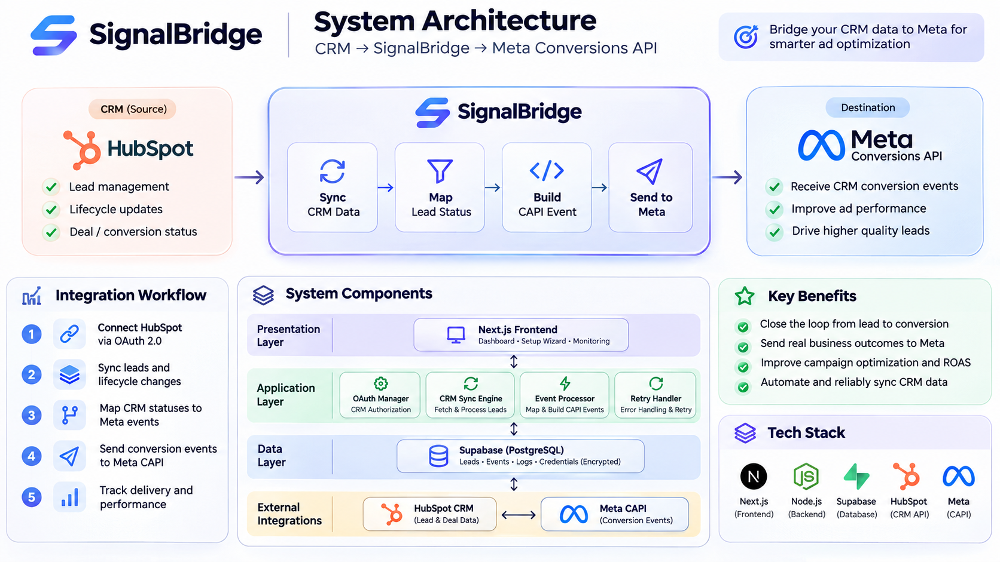
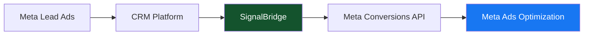
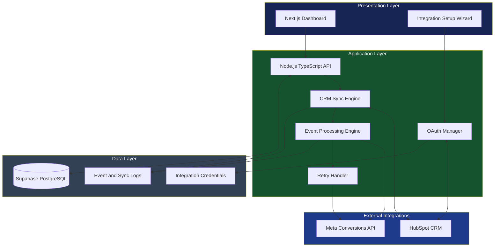
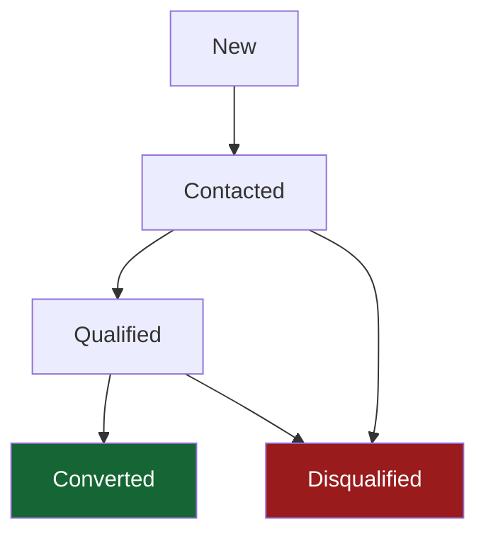
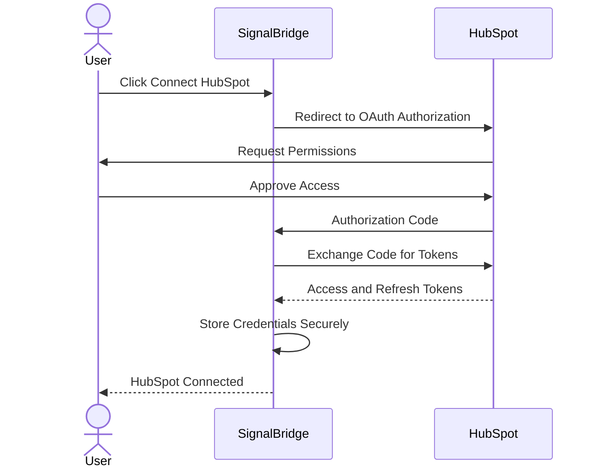
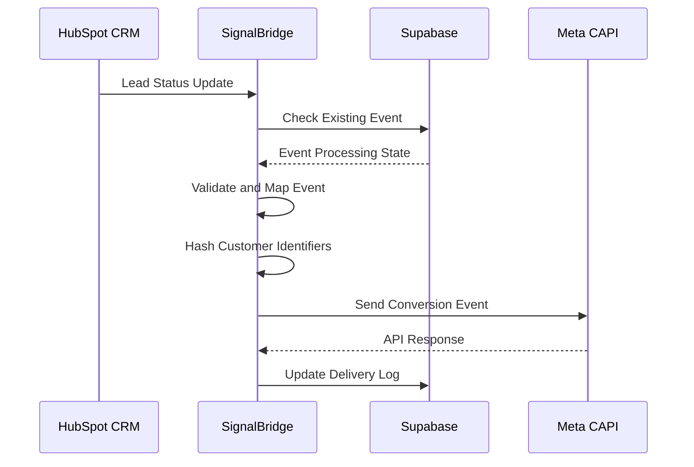

# SignalBridge 🚀

### Bridging CRM Data with Meta Conversions API

SignalBridge is a CRM-to-Meta integration platform that connects CRM systems with Meta's Conversions API (CAPI), enabling businesses to synchronize lead lifecycle events and send meaningful conversion signals back to Meta.

It bridges the gap between lead generation and actual business outcomes by connecting CRM data with Meta's advertising ecosystem.

<p align="center">
  
</p>

<p align="center">
  
  
  
  
  
</p>

---

## 📑 Table of Contents

- [Overview](#-overview)
- [The Problem](#-the-problem)
- [How SignalBridge Works](#-how-signalbridge-works)
- [System Architecture](#-system-architecture)
- [Core Features](#-core-features)
- [Integration Workflows](#-integration-workflows)
- [Technology Stack](#-technology-stack)
- [Project Structure](#-project-structure)
- [Getting Started](#-getting-started)
- [Environment Variables](#-environment-variables)
- [CRM Event Processing](#-crm-event-processing)
- [Security and Reliability](#-security-and-reliability)
- [Future Enhancements](#-future-enhancements)
- [Author](#-author)

---

## 🎯 Overview

Modern businesses generate leads through advertising platforms such as Facebook and Instagram.

However, a lead's journey doesn't end when a form is submitted.

A lead may subsequently become:

- Contacted
- Qualified
- Converted
- Disqualified

These lifecycle events are typically stored in CRM platforms such as HubSpot.

SignalBridge connects CRM lifecycle information to Meta, allowing businesses to send downstream conversion events through Meta's Conversions API.

### The Big Picture



**The goal:** Transform raw lead generation data into actionable conversion signals.

---

## ⚠️ The Problem

Traditional lead generation campaigns primarily optimize around form submissions.

But a submitted lead does not necessarily mean a successful business outcome.

Consider this example:

| Lead | CRM Status | Business Outcome |
|---|---|---|
| Lead A | New | Not contacted |
| Lead B | Contacted | Follow-up pending |
| Lead C | Qualified | High-intent prospect |
| Lead D | Converted | Successful customer |
| Lead E | Disqualified | Not a potential customer |

Without CRM feedback, advertising platforms have limited visibility into what happens after lead acquisition.

### How SignalBridge Solves This

1. Connect the CRM with SignalBridge.
2. Retrieve and process lead lifecycle information.
3. Identify relevant status changes.
4. Map CRM statuses to Meta conversion events.
5. Send conversion events to Meta CAPI.
6. Enable Meta to use eligible conversion signals for campaign optimization.

---

## 🔄 How SignalBridge Works

SignalBridge follows a CRM synchronization and event delivery pipeline.


### Processing Steps

| Step | Description |
|---|---|
| 1. Connect | Authorize HubSpot using OAuth 2.0 |
| 2. Synchronize | Retrieve CRM leads and lifecycle information |
| 3. Detect | Identify relevant status changes |
| 4. Transform | Map CRM statuses to Meta events |
| 5. Process | Normalize and hash customer identifiers |
| 6. Deliver | Send conversion events to Meta CAPI |
| 7. Monitor | Record delivery results and failures |

---

## 🏗️ System Architecture

SignalBridge uses a modular architecture consisting of four major layers.

### Architecture Diagram


### Architecture Overview



### Architecture Responsibilities

| Component | Responsibility |
|---|---|
| Next.js Frontend | Dashboard and integration configuration |
| Node.js Backend | Business logic and API orchestration |
| OAuth Manager | Secure CRM authorization |
| CRM Sync Engine | Retrieves and synchronizes lead data |
| Event Processor | Maps CRM changes into Meta events |
| Supabase | Persistent data storage |
| Retry Handler | Handles transient API failures |
| Logging | Tracks synchronization and delivery outcomes |

---

## ✨ Core Features

### 1. CRM Integration

Connect HubSpot using OAuth 2.0.

- Secure authorization.
- Access and refresh token management.
- CRM lead retrieval.
- Lead lifecycle synchronization.

### 2. Meta Conversions API Integration

Send CRM conversion events to Meta.

- Dataset ID configuration.
- Access token configuration.
- Event payload generation.
- Customer information hashing.
- API response handling.

### 3. Lead Lifecycle Tracking

Track the progression of leads throughout the sales funnel.



### 4. Event Processing

SignalBridge converts CRM lifecycle updates into standardized Meta event payloads.

Example event mapping:

| CRM Status | Meta Event |
|---|---|
| Qualified | QualifiedLead |
| Converted | Purchase or configured custom event |
| Other lifecycle stages | Configurable custom events |

Event mapping should be configurable according to the advertiser's dataset and optimization requirements.

### 5. Monitoring and Error Handling

- Track synchronization attempts.
- Record successful event deliveries.
- Capture API errors.
- Retry transient failures.
- Maintain processing logs.

---

## 🔌 Integration Workflows

### 1. HubSpot OAuth Integration

OAuth 2.0 enables users to securely authorize SignalBridge to access their HubSpot CRM.



### 2. Meta CAPI Integration

Once a relevant CRM lifecycle update is detected, SignalBridge processes the event and delivers it to Meta.



---

## 🛠️ Technology Stack

| Layer | Technology |
|---|---|
| Frontend | Next.js |
| Language | TypeScript / JavaScript |
| Backend | Node.js |
| Database | Supabase / PostgreSQL |
| CRM Integration | HubSpot API |
| Advertising Integration | Meta Conversions API |
| Authentication | OAuth 2.0 |
| API Communication | REST APIs |
| Version Control | Git / GitHub |

---

## 📁 Project Structure

The following is a suggested logical organization. Update it to reflect the actual repository structure.

```text
signalbridge/
│
├── frontend/
│   ├── app/
│   ├── components/
│   ├── hooks/
│   └── lib/
│
├── backend/
│   ├── src/
│   │   ├── config/
│   │   ├── controllers/
│   │   ├── routes/
│   │   ├── services/
│   │   │   ├── hubspot/
│   │   │   └── meta/
│   │   ├── middleware/
│   │   ├── jobs/
│   │   └── utils/
│   │
│   └── package.json
│
├── docs/
│   └── images/
│       └── signalbridge-architecture.png
│
├── .env.example
├── .gitignore
└── README.md
```

---

## 🚀 Getting Started

### Prerequisites

Before running SignalBridge, ensure you have:

- Node.js (LTS recommended)
- npm
- Git
- Supabase project
- HubSpot Developer App
- Meta Business Portfolio
- Meta Events Manager dataset

### 1. Clone the Repository

```bash
git clone https://github.com/toyouin2000/signalbridge.git

cd signalbridge
```

### 2. Install Dependencies

For a project organized into separate frontend and backend directories:

```bash
cd frontend
npm install
```

In another terminal:

```bash
cd backend
npm install
```

If your repository uses a single Next.js application or a different monorepo structure, install dependencies using its root `package.json` instead.

### 3. Configure Environment Variables

Create the required `.env` files in the relevant application directories.

Refer to the environment variable section below.

### 4. Start the Application

Frontend:

```bash
cd frontend
npm run dev
```

Backend:

```bash
cd backend
npm run dev
```

The actual startup commands depend on the scripts defined in your `package.json` files.

### 5. Access the Application

```text
Frontend: http://localhost:3000
```

Use the backend URL configured in your environment.

---

## 🔐 Environment Variables

Example configuration:

```env
# Application
PORT=5000
NODE_ENV=development

# Supabase
SUPABASE_URL=
SUPABASE_ANON_KEY=
SUPABASE_SERVICE_ROLE_KEY=

# HubSpot OAuth
HUBSPOT_CLIENT_ID=
HUBSPOT_CLIENT_SECRET=
HUBSPOT_OAUTH_REDIRECT_URI=

# Meta CRM CAPI
META_CRM_DATASET_ID=
META_CRM_ACCESS_TOKEN=

# Frontend
NEXT_PUBLIC_API_URL=
```

### Security Recommendations

- Never commit `.env` files.
- Keep Meta access tokens on the backend.
- Never expose Supabase service-role credentials to the frontend.
- Encrypt OAuth credentials at rest.
- Use HTTPS for production OAuth redirects.
- Rotate credentials if they are exposed.
- Validate OAuth state parameters to prevent CSRF attacks.

---

## 📊 CRM Event Processing

A typical CRM conversion event contains the following fields:

| Field | Description |
|---|---|
| event_name | Conversion event name |
| event_time | Unix timestamp of conversion |
| action_source | Source of the conversion |
| event_id | Unique event identifier |
| user_data | Hashed customer identifiers |
| custom_data | Optional conversion metadata |

### Example Meta CAPI Payload

```json
{
  "data": [
    {
      "event_name": "QualifiedLead",
      "event_time": 1794499200,
      "event_id": "lead_123_qualified",
      "action_source": "system_generated",
      "user_data": {
        "em": [
          "SHA256_HASHED_EMAIL"
        ]
      }
    }
  ]
}
```

The example is illustrative. Production events should use the actual CRM conversion timestamp and correctly normalized, SHA-256-hashed customer identifiers.

The event name, action source, and required fields must comply with the selected Meta integration and API requirements.

---

## 🛡️ Security and Reliability

SignalBridge follows these engineering principles:

| Principle | Implementation |
|---|---|
| Authentication | OAuth 2.0 |
| Credential Security | Backend-only secrets and encryption |
| Data Privacy | Normalization and hashing of identifiers |
| Reliability | Retry handling |
| Observability | API and event logs |
| Data Integrity | Event identifiers and duplicate prevention |
| Scalability | Modular integration architecture |

### Reliability Considerations

- Use idempotency controls to avoid duplicate conversion events.
- Respect Meta API rate limits.
- Retry transient failures with exponential backoff.
- Avoid retrying permanent validation errors.
- Store event delivery status for troubleshooting.
- Use least-privilege CRM permissions.
- Securely handle OAuth token refresh and expiration.

---

## 🔮 Future Enhancements

- [ ] Support additional CRMs such as Salesforce and Zoho.
- [ ] Support Meta Lead Ads ingestion.
- [ ] Configurable CRM-to-Meta event mapping.
- [ ] Automated scheduled synchronization.
- [ ] Advanced event delivery dashboard.
- [ ] Dead-letter queue for failed events.
- [ ] Webhook-based real-time synchronization.
- [ ] Multi-tenant organization management.
- [ ] Event Match Quality monitoring.
- [ ] Integration health monitoring.

---

## 💡 Product Vision

SignalBridge aims to make CRM-to-advertising integrations easier, more reliable, and more accessible.

By connecting lead acquisition data with actual business outcomes, businesses can build a more complete feedback loop between their CRM and advertising platforms.

**From lead generation to revenue intelligence.**

---

## 👨‍💻 Author

**Dishank Ojha**

Product Engineer | Full-Stack Developer | AI & Integration Systems

- GitHub: [@toyouin2000](https://github.com/toyouin2000)
- Project: [SignalBridge](https://github.com/toyouin2000/signalbridge)

---

<p align="center">
  <strong>⭐ If you find this project interesting, consider giving the repository a star!</strong>
</p>
